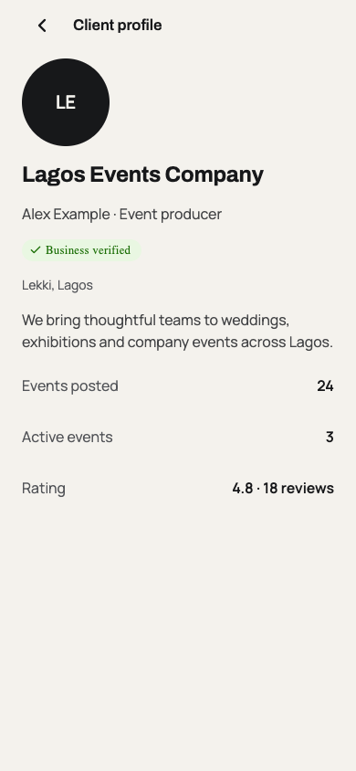
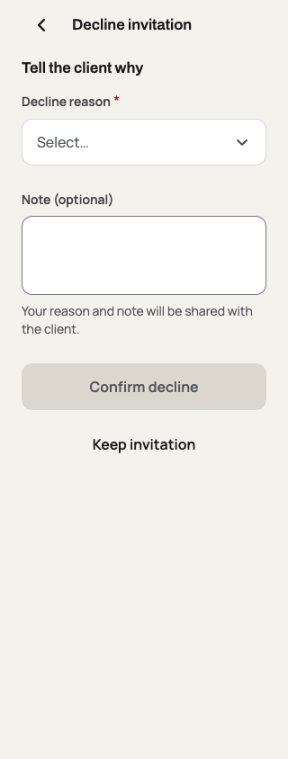
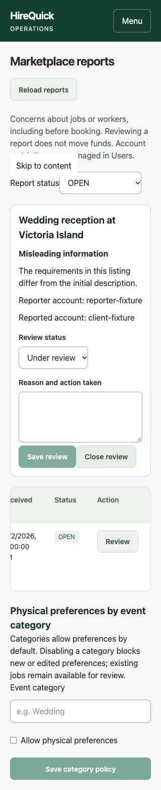

# Marketplace gap closure — 2 October 2026

Local implementation following the review of the first two pages of the [original HireQuick design](https://www.figma.com/design/anF6cZBOUxisKBBgV5LKVOxT/HireQuick?node-id=0-3336). Existing work on client verification and uploads was preserved. Nothing was deployed.

## Delivered

- Ordinary application withdrawal before booking, using the same locks as recruitment and checkout. Pending-payment and confirmed bookings stay in the booking lifecycle.
- Select up to 50 workers, review/remove the selection, carry it through event creation, and send an atomic batch of invitations. Repeated requests preserve existing invitations.
- Optional worker physical attributes: gender, age, height, UK shoe size, body type, clothing size, skin tone and hairstyle. Job preferences require an explanation; admins can disable preferences by category. Attributes do not control automatic eligibility or ranking.
- Decline reason and optional note, shared with the client. Older status-only clients remain compatible. Repeated declines preserve the original explanation and repair legacy application state.
- Pre-booking job/worker reports, private admin queue, guarded review transitions and category controls. Reports do not move money or suspend accounts.
- Job search across available, applied and saved jobs, and native sharing via `hirequick://jobs/<id>`. Public share text omits the precise venue. Pending links can resume after sign-in/profile setup for up to 24 hours.
- Public client/company profiles: photo, introduction, position, city, verification labels, ratings and event statistics. Contact email remains private. Export/erasure and storage cleanup include the new fields and client avatars.

## Validation

Tests used PostgreSQL on localhost port 55439, database `hirequick_test`, with the repository's disposable-database guard enabled (`CI=true`). The final report-target constraints were also migrated and tested in fresh schema `hq_validation_20261002122700_5f169b23`; attempts to delete referenced targets are rejected. All provider credentials were replaced with test/dummy values; no live provider operations were performed.

| Check | Result |
| --- | --- |
| New migration applied to disposable database; Prisma migration diff | Passed; no schema difference |
| API marketplace suite | 14 passed |
| Recruitment and venue-privacy regressions | 15 + 9 passed |
| Upload and existing profile-photo regressions | 11 + 5 passed |
| Profile onboarding and client-verification regressions | 8 + 7 passed |
| Consent/export/erasure and checkout-privacy regressions | 5 + 5 passed |
| Total distinct API tests across targeted runs | 79 passed |
| Mobile unit suite, including new route/selection boundary cases | 68 passed |
| Shared domain/schema suite | 82 passed |
| Workspace type checks, test-source type checks, lint and test lint | Passed; existing warnings in environment regex and native Smile plugin |
| Admin production build | Passed |
| iOS and Android JavaScript/assets exports | Passed |
| Documentation links and whitespace checks | Passed |

Tests exercise duplicate reports, role boundaries, draft/unverified targets, stale moderation decisions, optional field validation/removal, private profile-field exclusion, venue-safe search, category policy enforcement, erasure, avatar ownership/finalization/cleanup, decline retries, application ownership, reservation/withdrawal races, atomic invitations and legacy invitation compatibility. The onboarding unit fixture was updated to model the new transactional profile write; no failing production assertion was removed.

A temporary React Native Web harness imported six actual mobile screens with fixture API/auth/router/native boundaries. Report, public client profile, physical-attribute editing, account settings, invitation and invitation selection rendered at 320 and 390 pixels without document-width overflow or browser errors. Interactions covered decimal shoe sizes, required report and decline fields, successful submission, and selected-worker handoff. A final check confirmed the decline form opens above the fold at 320 pixels. The actual admin Reports page was exercised with intercepted fixture responses at 320, 390 and 1440 pixels, including review validation and resolution.

## Limits and rollout

The previews use sample data, not production records. Installed-device behavior, native share sheets, cold-start links through real OTP/verification, native photo capture/upload and screen-reader behavior remain unverified. No simulator or Android SDK was available. App sharing requires HireQuick to be installed; there is no web listing or universal-link fallback.

Apply `20261002103905_marketplace_profile_and_hiring` before deploying the API/admin changes, then ship the updated mobile app. The signed native release and production migration were not performed here. Reports remain one per reporter/target and have no automatic age-based purge. Category disablement affects new/edited preferences, not existing listings.

## Screenshots — sample data

